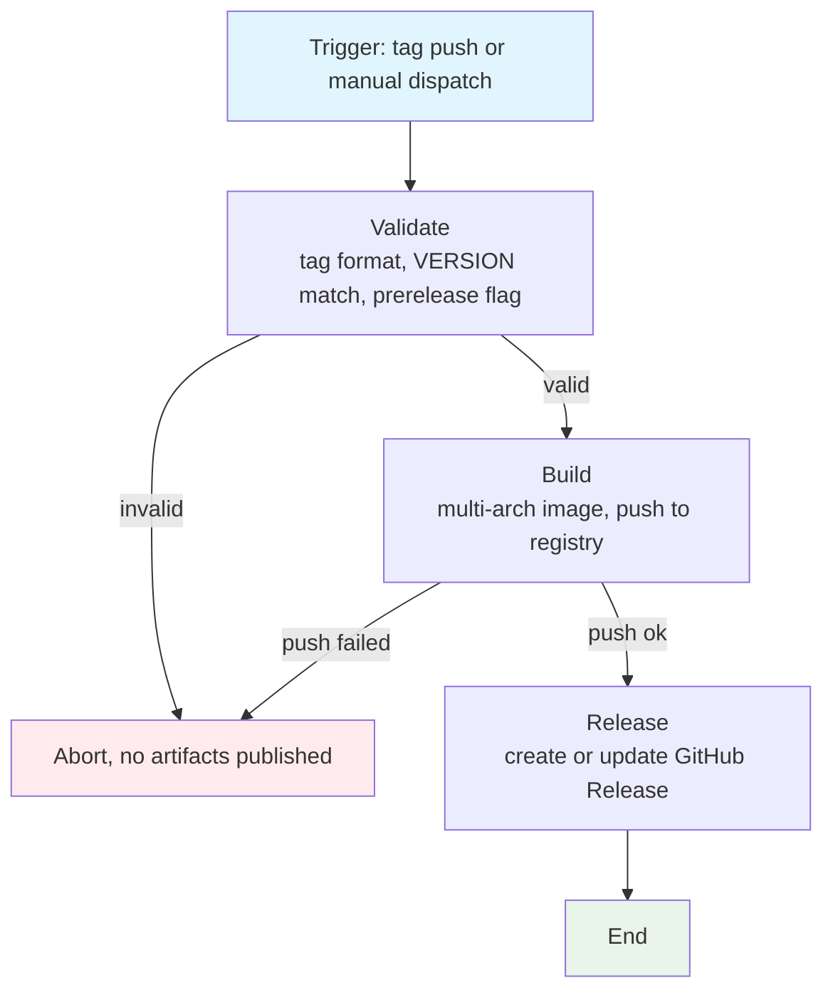

## Workflow Overview

**Purpose**: Turn an annotated/pushed release tag into a published multi-arch container image and a matching GitHub Release entry.
**Trigger Events**: Push of a semver tag (`X.Y.Z` or `X.Y.Z-suffix`); manual dispatch naming an existing tag.
**Target Environments**: GitHub-hosted `ubuntu-latest` runners; publication targets are Docker Hub and the repository's GitHub Releases.

## Execution Flow Diagram



## Jobs & Dependencies

| Job Name | Purpose | Dependencies | Execution Context |
|----------|---------|--------------|-------------------|
| `validate` | Reject malformed tags and tag/VERSION drift; derive prerelease flag | none | `ubuntu-latest` |
| `build` | Build and push a `linux/amd64` + `linux/arm64` image tagged with the release tag | `validate` | `ubuntu-latest` + Buildx/QEMU |
| `release` | Publish the GitHub Release using the changelog section for the tag | `validate`, `build` | `ubuntu-latest` |

## Requirements Matrix

### Functional Requirements

| ID | Requirement | Priority | Acceptance Criteria |
|----|-------------|----------|-------------------|
| REQ-001 | Only semver-like tags may start a release | High | Tag `0.7.3-beta` proceeds; tag `nightly` aborts in `validate` |
| REQ-002 | `VERSION` file must equal the tag being released | High | Mismatch aborts before any image push |
| REQ-003 | Image is published under the tag name | High | `docker pull <image>:0.7.3-beta` succeeds after run |
| REQ-004 | Pre-release tags must not move `latest` | High | After `0.7.3-beta`, `latest` still points at the previous stable digest |
| REQ-005 | Image is multi-arch | High | `docker buildx imagetools inspect <image>:0.7.3-beta` lists both `linux/amd64` and `linux/arm64` |
| REQ-006 | GitHub Release is created from the matching CHANGELOG section | Medium | Release body contains the `## vX.Y.Z` block only |
| REQ-007 | Pre-release tags produce a GitHub pre-release | Medium | Release for `0.7.3-beta` has `prerelease: true` |
| REQ-008 | Re-running is safe | Medium | Second run updates the existing Release instead of erroring |
| REQ-009 | Manual dispatch can re-release an existing tag | Low | Dispatch with `tag=0.7.3-beta` reproduces the same artifacts |

### Security Requirements

| ID | Requirement | Implementation Constraint |
|----|-------------|---------------------------|
| SEC-001 | Registry credentials are never echoed | Credentials come from repository secrets and are consumed only by the registry login step |
| SEC-002 | Release creation uses the scoped workflow token | Workflow runs with `permissions: contents: write` only; no PAT with broader scope |
| SEC-003 | Fork-originated tag pushes cannot publish | Secrets are absent in forks, so the registry login step fails closed |
| SEC-004 | Actions are pinned to major versions from the Docker/`actions` orgs | No arbitrary third-party action receives credentials |

### Performance Requirements

| ID | Metric | Target | Measurement Method |
|----|-------|--------|-------------------|
| PERF-001 | Wall-clock duration (cold cache) | < 20 min | Workflow run duration in Actions UI |
| PERF-002 | Wall-clock duration (warm `gha` cache) | < 10 min | Second run of the same commit |
| PERF-003 | Redundant runs | 0 concurrent per tag | `concurrency` group keyed on the tag, no cancellation |

## Input/Output Contracts

### Inputs

```yaml
# Manual dispatch
tag: string  # Purpose: existing tag to (re)release, e.g. "0.7.3-beta"

# Repository trigger
push.tags:
  - '[0-9]+.[0-9]+.[0-9]+'      # stable
  - '[0-9]+.[0-9]+.[0-9]+-*'    # pre-release

# Files consumed from the tagged commit
VERSION:  file  # single line, must equal the tag
CHANGELOG.md: file  # heading "## vX.Y.Z" anchors the release body
Dockerfile: file
```

### Outputs

```yaml
image_tags: string[]     # Description: "<image>:<tag>" plus "latest" when stable
image_digest: sha256     # Description: pushed manifest-list digest, surfaced in the job summary
github_release: record   # Description: Release with title "v<tag>", changelog body, prerelease flag
```

### Secrets & Variables

| Type | Name | Purpose | Scope |
|------|------|---------|-------|
| Secret | `DOCKER_USERNAME` | Registry account for push | Repository |
| Secret | `DOCKER_PASSWORD` | Registry token for push | Repository |
| Secret | `GITHUB_TOKEN` | Create/update the Release | Auto-provided, `contents: write` |
| Variable | `DOCKER_IMAGE` | Target image `owner/name`; falls back to a repository default | Repository |

## Execution Constraints

### Runtime Constraints

- **Timeout**: Default; no explicit override. Cold build observed under 20 min.
- **Concurrency**: One run per tag (`release-<tag>`); in-progress runs are not cancelled, so a retry queues.
- **Resource Limits**: Standard GitHub-hosted runner; QEMU emulation covers `arm64`.

### Environmental Constraints

- **Runner Requirements**: `ubuntu-latest` with Docker Buildx available.
- **Target Platforms**: `linux/amd64`, `linux/arm64` — both mandatory. A single-arch image would fail on arm64 nodes with `no match for platform in manifest`.
- **Network Access**: Container registry, Go module proxy, Alpine package repositories, GitHub API.
- **Permissions**: `contents: write` for the Release job.
- **Toolchain**: Go version is dictated by `go.mod` and the `Dockerfile` builder image; the workflow does not pin a conflicting toolchain.

## Error Handling Strategy

| Error Type | Response | Recovery Action |
|------------|----------|-----------------|
| Malformed tag | `validate` fails with an explicit `::error::` | Delete the tag, push a corrected one |
| Tag/VERSION drift | `validate` fails before any push | Bump `VERSION`, re-tag |
| Registry login failure (missing/wrong secrets) | `build` fails; no image, no Release | Add/fix `DOCKER_USERNAME` and `DOCKER_PASSWORD`, re-run |
| Build failure | `build` fails; `release` is skipped | Fix the commit, delete tag, re-tag |
| Release already exists | Release step edits the existing entry | None; idempotent |
| Changelog section missing | Release body falls back to a generated note listing the image | Add the `## vX.Y.Z` block and re-run |

## Quality Gates

| Gate | Criteria | Bypass Conditions |
|------|----------|-------------------|
| Tag format | Matches `X.Y.Z` or `X.Y.Z-suffix` | None |
| Version consistency | `VERSION` equals tag | None |
| Image build | `docker build` for both platforms succeeds (CGO + libwebp/libjpeg) | None |
| Release body | Non-empty changelog section | Falls back to generated body |

## Monitoring & Observability

### Key Metrics

- **Success Rate**: 100% of runs that reach `build` should reach `release`.
- **Execution Time**: Tracked via run duration; regression if a warm run exceeds 10 min.
- **Resource Usage**: Buildx `gha` cache hit ratio inferred from duration.

### Alerting

| Condition | Severity | Notification Target |
|-----------|----------|-------------------|
| Release run failed | High | Repository watchers / Actions failure email |
| `latest` moved by a pre-release | High | Manual review of the registry tag list |
| Digest published for only one platform | High | `imagetools inspect` check after release |

## Integration Points

### External Systems

| System | Integration Type | Data Exchange | SLA Requirements |
|--------|------------------|---------------|------------------|
| Docker Hub | Push API | OCI manifest list + layers | Best effort; fail closed |
| GitHub Releases | REST via `gh` CLI | Tag, title, markdown body | Idempotent, safe to retry |

### Dependent Workflows

| Workflow | Relationship | Trigger Mechanism |
|----------|--------------|-------------------|
| None in this repository | — | Release is the terminal workflow |
| Upstream `sync-releases` (other repo) | Downstream consumer of tags | Separate repository; not triggered from here |

## Compliance & Governance

### Audit Requirements

- **Execution Logs**: Retained per GitHub default (90 days for public repositories).
- **Approval Gates**: None automated; publishing requires write access to push a tag.
- **Change Control**: This specification is updated before modifying the workflow.

### Security Controls

- **Access Control**: Tag creation is the release gate; only collaborators with write access can trigger a publish.
- **Secret Management**: Registry credentials stored as repository secrets, never in workflow files.
- **Vulnerability Scanning**: None in this workflow; dependency updates are handled separately.

## Edge Cases & Exceptions

### Scenario Matrix

| Scenario | Expected Behavior | Validation Method |
|----------|-------------------|-------------------|
| Tag pushed twice (same name) | Second run republishes image; Release is edited, not duplicated | Re-run and confirm single Release |
| Tag on a commit where `VERSION` is stale | Aborts in `validate` | Push a tag with mismatched version |
| `-beta`/`-rc` suffix | Image pushed, `latest` untouched, Release marked pre-release | Inspect registry tags and Release flags |
| Manual dispatch on a branch | Checkout resolves the named tag, not the branch head | Dispatch with an existing tag |
| Fork push of a tag | Fails at registry login (no secrets) | Push a tag in a fork |
| Registry outage | `build` fails; Release skipped | Simulated by invalid credentials |

## Validation Criteria

### Workflow Validation

- **VLD-001**: Workflow file parses as valid YAML and is picked up by Actions (`workflows` API returns it).
- **VLD-002**: `validate` rejects a non-semver tag.
- **VLD-003**: `imagetools inspect` shows `linux/amd64` and `linux/arm64` for the published tag.
- **VLD-004**: `latest` digest is unchanged after a pre-release run.
- **VLD-005**: Release body equals the corresponding CHANGELOG section.

### Performance Benchmarks

- **PERF-001**: Cold-cache release completes under 20 minutes.
- **PERF-002**: Warm-cache re-run completes under 10 minutes.

## Change Management

### Update Process

1. **Specification Update**: Modify this document first
2. **Review & Approval**: Maintainer review on the pull request
3. **Implementation**: Apply changes to `.github/workflows/release.yml`
4. **Testing**: Validate with a throwaway pre-release tag
5. **Deployment**: Merge; releases start using the new definition on the next tag

### Version History

| Version | Date | Changes | Author |
|---------|------|---------|--------|
| 1.0 | 2026-11-03 | Initial specification; replaces `publish_docker_image.yml` (branch-push, single-purpose image build) with a tag-driven release workflow | DevOps Team |

## Related Specifications

- `Dockerfile` — multi-stage build, CGO + libwebp/libjpeg runtime deps
- `CHANGELOG.md` — release body source, also the version source for local builds
- `VERSION` — release version of record, enforced against the tag
